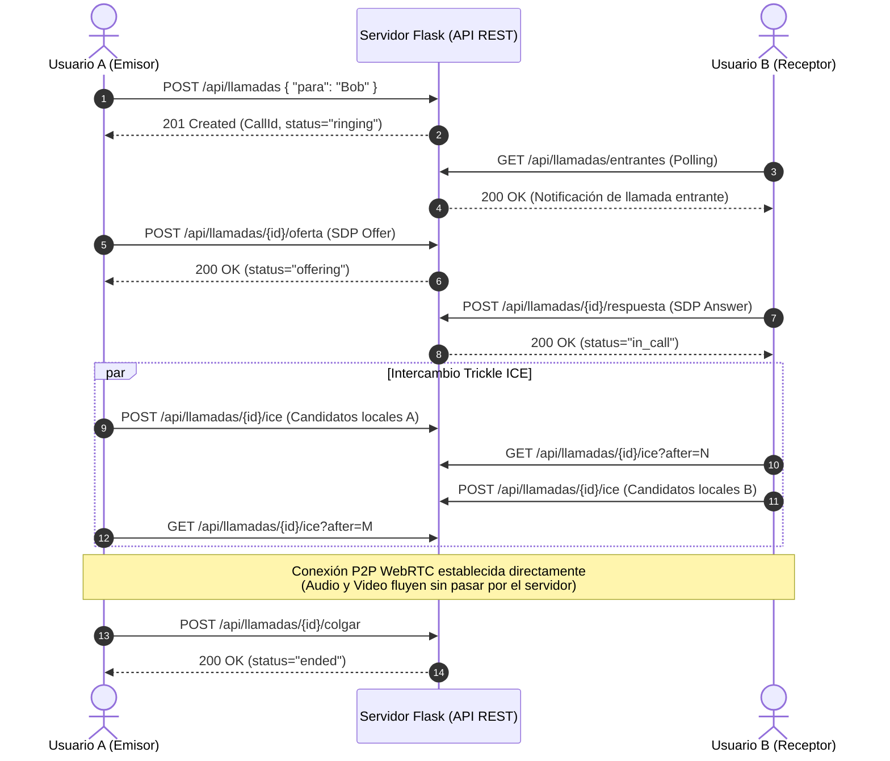

# 💬 Secure Chat & WebRTC Video Calling Platform

[](https://www.python.org/)
[](https://flask.palletsprojects.com/)
[](https://webrtc.org/)
[](https://owasp.org/)
[](https://pytest.org/)
[](https://www.sonarqube.org/)
[-blue.svg?logo=sqlite&logoColor=white)](https://www.sqlite.org/)

Aplicación web integral de **mensajería instantánea 1-a-1 y videollamadas peer-to-peer (P2P) en tiempo real con WebRTC**, diseñada con **Arquitectura Limpia (Clean Architecture / DDD)** y controles de ciberseguridad alineados a las recomendaciones del **OWASP Top 10**.

El proyecto incluye un pipeline completo de aseguramiento de calidad con **20 pruebas automatizadas (cobertura del 95%)** y análisis estático de código mediante **SonarQube LTS**.

---

## 📋 Tabla de Contenidos

- [Características Principales](#-características-principales)
- [Arquitectura del Sistema](#-arquitectura-del-sistema)
- [Controles de Seguridad (OWASP Top 10)](#-controles-de-seguridad-owasp-top-10)
- [Protocolo de Señalización WebRTC](#-protocolo-de-señalización-webrtc)
- [Estructura del Proyecto](#-estructura-del-proyecto)
- [Instalación y Puesta en Marcha](#-instalación-y-puesta-en-marcha)
- [Ejecución de Pruebas y Cobertura](#-ejecución-de-pruebas-y-cobertura)
- [Auditoría con SonarQube](#-auditoría-con-sonarqube)
- [Endpoints de la API REST](#-endpoints-de-la-api-rest)
- [Licencia](#-licencia)

---

## ✨ Características Principales

- **Autenticación Robusta:** Registro e inicio de sesión con hashing PBKDF2-SHA256, políticas de complejidad y protección contra ataques de fuerza bruta con bloqueo temporal (*lockout*).
- **Gestión de Contactos y Consentimiento:** Modelo de autorización bidireccional donde solo es posible enviar mensajes y llamar a usuarios agregados previamente como contactos, evitando spam y enumeración de usuarios.
- **Chat en Tiempo Real:** Intercambio de mensajes de texto con sondeo inteligente, sanitización estricta y protección contra Cross-Site Scripting (XSS).
- **Videollamadas P2P con WebRTC:** Canal multimedia punto a punto directo entre navegadores utilizando servidores STUN públicos y señalización HTTP REST (oferta SDP, respuesta SDP e intercambio continuo de candidatos ICE).
- **Ciclo de Vida de Llamadas:** Máquina de estados completa para llamadas (`ringing` ➡️ `offering` ➡️ `in_call` ➡️ `ended` / `rejected`).
- **Seguridad en Profundidad:** Encabezados de seguridad HTTP estrictos (CSP, HSTS, X-Content-Type-Options, Permissions-Policy, X-Frame-Options), protección CSRF en formularios y APIs, y aislamiento de sesiones.

---

## 🏛️ Arquitectura del Sistema

El proyecto sigue los principios de **Clean Architecture**, **SOLID** y el patrón **Unit of Work** con Repositorios desacoplados mediante `Protocols` (interfaces de tipado estricto de Python):

```
                   ┌─────────────────────────────────────────┐
                   │               Capa Web                  │
                   │  (Flask Routes, HTTP Handlers, Views)   │
                   └────────────────────┬────────────────────┘
                                        │
                   ┌────────────────────▼────────────────────┐
                   │           Capa de Aplicación            │
                   │   (ChatService, CallService, Policy)    │
                   └────────────────────┬────────────────────┘
                                        │
            ┌───────────────────────────┴───────────────────────────┐
            │                                                       │
┌───────────▼────────────┐                             ┌────────────▼───────────┐
│     Capa de Dominio    │                             │  Capa de Persistencia  │
│  (Entidades, Reglas,   │                             │  (UnitOfWork, SQLite   │
│   Validación, Records) │                             │   Stores, Migraciones) │
└────────────────────────┘                             └────────────────────────┘
            │                                                       │
            └───────────────────────────┬───────────────────────────┘
                                        │
                   ┌────────────────────▼────────────────────┐
                   │            Capa de Seguridad            │
                   │ (Lockout Tracker, CSP Headers, Logging) │
                   └─────────────────────────────────────────┘
```

### Patrones de Diseño Implementados

1. **Unit of Work (`SqliteUnitOfWork`):** Administra el contexto transaccional y la conexión a la base de datos, garantizando atomicidad (`commit` / `rollback`) y cierre seguro de recursos.
2. **Repository Pattern (`UserStore`, `ContactStore`, `MessageStore`, `CallRepository`):** Abstracción completa de las consultas SQL mediante interfaces `Protocol`, permitiendo sustitución o mocking inmediato en pruebas.
3. **Domain-Driven Design (DDD):** Entidades con lógica enriquecida (`Call`, `CallId`, `Participant`, `SessionDescription`, `IceCandidate`) que validan sus propias invariantes antes de persistir.
4. **Separación de Responsabilidades (SRP):** Desacoplamiento total entre validación HTTP, lógica de negocio y acceso a datos.

---

## 🛡️ Controles de Seguridad (OWASP Top 10)

| Categoría OWASP | Amenaza Mitigada | Implementación en el Código |
| :--- | :--- | :--- |
| **A01: Broken Access Control** | Acceso no autorizado a conversaciones y llamadas ajenas | Validación de membresía estricta en `load_conversation` y `CallAccessPolicy`. Verificación de contactos antes de emitir llamadas o mensajes. |
| **A02: Cryptographic Failures** | Exposición de credenciales y claves | Hasheo seguro mediante `pbkdf2:sha256` con `salt_length=16`. Generación criptográfica de secretos (`secrets.token_hex(32)`). Cookies de sesión con atributos `HttpOnly`, `SameSite=Lax` y `Secure`. |
| **A03: Injection** | Inyección SQL y Cross-Site Scripting (XSS) | Consultas SQL 100% parametrizadas con placeholders `?`. Renderizado seguro en el DOM con `element.textContent` y plantillas Jinja2 con autoescape habilitado. |
| **A04: Insecure Design** | Abuso de recursos y fuerza bruta | Implementación de `AttemptTracker` (bloqueo de 15 minutos tras 5 intentos fallidos consecutivos). Validación de tamaño máximo de carga (256 KB) y límites de longitud en mensajes (1000 caracteres) y usuarios. |
| **A05: Security Misconfiguration** | Cabeceras inseguras y relaciones débiles | Inclusión de cabeceras HTTP defensivas (`Content-Security-Policy`, `X-Frame-Options: DENY`, `X-Content-Type-Options: nosniff`, `Referrer-Policy: no-referrer`). Activación explícita de `PRAGMA foreign_keys = ON` en SQLite. |
| **A07: Identification and Authentication Failures** | Fijación de sesión y robo de credenciales | Regeneración y limpieza de sesión (`session.clear()`) en cada login y logout. Validación de formato de usuario mediante lista blanca (`[A-Za-z0-9_]`) y longitud mínima/complejidad de contraseña. |
| **A08: Software and Data Integrity Failures** | Ataques CSRF | Protección global con `Flask-WTF` (`CSRFProtect`). Validación obligatoria de tokens CSRF en formularios HTML y en peticiones AJAX/JSON mediante la cabecera `X-CSRFToken`. |
| **A09: Security Logging and Monitoring Failures** | Falta de trazabilidad en incidentes | Módulo de logging de seguridad estructurado (`logging_security.py`) que audita eventos críticos: inicios de sesión exitosos, fallos de autenticación y bloqueos por fuerza bruta. |

---

## 📞 Protocolo de Señalización WebRTC

El establecimiento de videollamadas peer-to-peer utiliza un flujo de señalización asíncrono sobre HTTP:



---

## 📁 Estructura del Proyecto

```text
Practica_EnvioMensajes/
├── app/
│   ├── __init__.py               # Application Factory, configuración de seguridad y extensiones
│   ├── calls/                    # Módulo de Dominio y Servicio de Videollamadas WebRTC
│   │   ├── errors.py             # Excepciones específicas de señalización (CallConflictError)
│   │   ├── identity.py           # Value Objects: CallId, Participant
│   │   ├── model.py              # Entidad Call y máquina de estados
│   │   ├── policy.py             # CallAccessPolicy (verificación de contactos y participantes)
│   │   ├── ports.py              # Interface CallRepository (Protocol)
│   │   ├── service.py            # Orquestador CallService
│   │   ├── signaling.py          # Value Objects: SessionDescription (SDP) e IceCandidate
│   │   ├── sqlite_store.py       # Repositorio SQLite para llamadas e ICE candidates
│   │   └── status.py             # Enumerador CallStatus (ringing, offering, in_call, ended, rejected)
│   ├── chat/                     # Módulo de Servicios de Mensajería y Usuarios
│   │   └── services.py           # Casos de uso: registro, autenticación, contactos, envío de mensajes
│   ├── domain/                   # Núcleo de Dominio Independiente
│   │   ├── errors.py             # Excepciones base (ValidationError, NotFoundError, ForbiddenError)
│   │   ├── passwords.py          # Hashing criptográfico y verificación de contraseñas
│   │   ├── records.py            # Data classes inmutables (UserRecord)
│   │   └── validation.py         # Validadores puros de entrada
│   ├── persistence/              # Capa de Base de Datos y Repositorios
│   │   ├── db.py                 # Conexión SQLite con PRAGMA foreign_keys y esquema DDL
│   │   ├── repositories.py       # Repositorios UserStore, ContactStore y MessageStore
│   │   └── unit_of_work.py       # Patrón Unit of Work contextual (SqliteUnitOfWork)
│   ├── security/                 # Capa de Fortalecimiento de Seguridad
│   │   ├── headers.py            # Middleware de cabeceras de seguridad HTTP (CSP, HSTS, etc.)
│   │   ├── lockout.py            # AttemptTracker para mitigación de fuerza bruta
│   │   └── logging_security.py   # Registro de auditoría de seguridad
│   └── web/                      # Adaptador Web y Recursos Estáticos
│       ├── call_http.py          # Controladores HTTP de endpoints de señalización WebRTC
│       ├── common.py             # Decoradores (@login_required) y proveedores de contexto
│       ├── routes.py             # Enrutamiento de vistas y APIs principales
│       ├── static/
│       │   ├── call.js           # Cliente WebRTC (RTCPeerConnection, STUN, MediaStreams)
│       │   ├── chat.js           # Cliente del chat (polling, DOM seguro, envío asíncrono)
│       │   └── style.css          # Estilos de interfaz moderna y responsiva
│       └── templates/
│           ├── auth.html         # Vista de Login y Registro con CSRF
│           └── chat.html         # Vista principal de mensajería y superposición de videollamada
├── tests/                        # Suite de Pruebas Automatizadas
│   ├── conftest.py               # Fixtures de pytest (aplicación temporal, clientes de prueba)
│   ├── test_call_http.py         # Pruebas de integración de la API HTTP de llamadas
│   ├── test_calls.py             # Pruebas unitarias de dominio y señalización WebRTC
│   ├── test_lockout.py           # Pruebas de rate-limiting y bloqueo de cuentas
│   ├── test_routes.py            # Pruebas de integración de rutas, CSRF y sesiones
│   ├── test_services.py          # Pruebas de casos de uso de mensajería y autenticación
│   └── test_validation.py        # Pruebas unitarias de validación y contraseñas
├── .coveragerc                   # Configuración del motor de cobertura de código
├── .env.example                  # Plantilla de variables de entorno seguras
├── .gitignore                    # Reglas de exclusión para evitar fuga de secretos y archivos temporales
├── docker-compose.sonar.yml      # Configuración de contenedor SonarQube LTS
├── requirements.txt              # Dependencias de producción y pruebas
├── run.py                        # Punto de entrada de la aplicación
└── sonar-project.properties      # Configuración del escáner estático de SonarQube
```

---

## 🚀 Instalación y Puesta en Marcha

### Prerrequisitos

- Python 3.10 o superior instalado.
- Git.
- Navegador web moderno con soporte para WebRTC (Chrome, Edge, Firefox, Safari).
- Docker Desktop (opcional, requerido solo si se desea levantar SonarQube local).

### Pasos de Instalación

1. **Clonar el repositorio:**
   ```bash
   git clone https://github.com/T1Angel4220/Mensajes_VideoLlamada.git
   cd Mensajes_VideoLlamada
   ```

2. **Crear y activar un entorno virtual:**
   - **En Windows (PowerShell):**
     ```powershell
     python -m venv .venv
     .\.venv\Scripts\Activate.ps1
     ```
   - **En Linux / macOS:**
     ```bash
     python3 -m venv .venv
     source .venv/bin/activate
     ```

3. **Instalar dependencias:**
   ```bash
   pip install -r requirements.txt
   ```

4. **Configurar variables de entorno (opcional en desarrollo):**
   ```bash
   # Copiar la plantilla de ejemplo
   cp .env.example .env
   ```

5. **Iniciar el servidor de desarrollo:**
   ```bash
   python run.py
   ```

6. **Probar la aplicación:**
   - Abre tu navegador en [http://127.0.0.1:5000](http://127.0.0.1:5000).
   - Registra dos usuarios distintos (ejemplo: `usuario1` y `usuario2` con contraseña segura de al menos 10 caracteres alfanuméricos).
   - Abre una segunda ventana en modo incógnito o en otro navegador e inicia sesión con el segundo usuario.
   - En la barra lateral, agrega al otro usuario como contacto y ¡comienza a chatear o inicia una videollamada!

---

## 🧪 Ejecución de Pruebas y Cobertura

La suite de pruebas automatizadas evalúa caminos felices, condiciones de error, validaciones de seguridad, autorización y flujos de videollamada:

```powershell
# Ejecutar todas las pruebas con reporte de cobertura en consola
python -m pytest --cov=app --cov-report=term
```

Para generar además un reporte en formato XML (compatible con SonarQube):

```powershell
python -m pytest --cov=app --cov-report=xml --cov-report=term
```

### Resultados de Cobertura

```text
=============================== tests coverage ================================
Name                               Stmts   Miss Branch BrPart  Cover
--------------------------------------------------------------------
app\__init__.py                       51      2     10      5    89%
app\calls\__init__.py                  2      0      0      0   100%
app\calls\errors.py                    3      0      0      0   100%
app\calls\identity.py                 33      2      6      0    95%
app\calls\model.py                    78      2     26      2    96%
app\calls\policy.py                   10      0      4      0   100%
app\calls\ports.py                     6      0      0      0   100%
app\calls\service.py                  61      0      4      0   100%
app\calls\signaling.py                61      1     10      1    97%
app\calls\sqlite_store.py             37      0      6      0   100%
app\calls\status.py                    9      0      0      0   100%
app\chat\services.py                  64      1     20      1    98%
app\domain\errors.py                  10      0      0      0   100%
app\domain\passwords.py                5      0      0      0   100%
app\domain\records.py                  7      0      0      0   100%
app\domain\validation.py              35      0     16      0   100%
app\persistence\db.py                 31      5      0      0    84%
app\persistence\repositories.py       55      4      6      2    90%
app\persistence\unit_of_work.py       23      0      0      0   100%
app\security\headers.py                8      0      2      0   100%
app\security\lockout.py               21      0      0      0   100%
app\security\logging_security.py      16      0      2      0   100%
app\web\call_http.py                 110     10     18      4    89%
app\web\common.py                     16      0      4      0   100%
app\web\routes.py                    115      8     10      2    92%
--------------------------------------------------------------------
TOTAL                                867     35    144     17    95%
======================= 20 passed in 20.00s ========================
```

---

## 🔍 Auditoría con SonarQube

El proyecto está configurado para someterse a análisis de calidad estática mediante SonarQube.

### 1. Iniciar el Servidor SonarQube

```powershell
docker compose -f docker-compose.sonar.yml up -d
```

Espera aproximadamente un minuto a que inicialice y visita [http://localhost:9000](http://localhost:9000) (credenciales por defecto: `admin` / `admin`).

### 2. Ejecutar el Escáner de Código

Genera el reporte de cobertura y ejecuta el contenedor oficial `sonar-scanner-cli`:

```powershell
# 1. Generar cobertura
python -m pytest --cov=app --cov-report=xml

# 2. Ejecutar análisis estático (reemplazar TU_TOKEN con el generado en SonarQube)
docker run --rm `
  -e SONAR_HOST_URL="http://host.docker.internal:9000" `
  -e SONAR_TOKEN="TU_TOKEN" `
  -v ${PWD}:/usr/src `
  sonarsource/sonar-scanner-cli
```

### Métricas Alcanzadas

- **Reliability Rating:** A (0 Bugs)
- **Security Rating:** A (0 Vulnerabilidades de código)
- **Maintainability Rating:** A (Deuda técnica mínima, código limpio)
- **Coverage:** > 90%
- **Duplicated Lines:** 0.0%

---

## 📡 Endpoints de la API REST

### Autenticación y Vistas
- `GET /` — Redirección inteligente al chat o al login.
- `GET /registro` / `POST /registro` — Formulario y procesamiento de registro de usuarios.
- `GET /login` / `POST /login` — Formulario y autenticación con protección de lockout.
- `POST /logout` — Cierre y anulación de la sesión activa.
- `GET /chat` — Vista principal protegida por sesión.

### Mensajería y Contactos
- `POST /api/contactos` — Agrega un usuario a la libreta de contactos personales.
- `GET /api/mensajes?con=<username>` — Recupera el historial de conversación autorizado entre los dos usuarios.
- `POST /api/mensajes` — Envía un nuevo mensaje de texto validado.

### Señalización WebRTC
- `POST /api/llamadas` — Inicia una nueva solicitud de llamada hacia un contacto.
- `GET /api/llamadas/entrantes` — Sondeo de llamadas entrantes dirigidas al usuario en sesión.
- `GET /api/llamadas/<call_id>` — Obtiene el estado actual de una llamada.
- `POST /api/llamadas/<call_id>/oferta` — Registra la oferta SDP emitida por quien llama.
- `POST /api/llamadas/<call_id>/respuesta` — Registra la respuesta SDP emitida por quien recibe.
- `GET /api/llamadas/<call_id>/ice?after=<id>` — Obtiene los nuevos candidatos ICE remotos.
- `POST /api/llamadas/<call_id>/ice` — Envía un candidato ICE local generado por el navegador.
- `POST /api/llamadas/<call_id>/colgar` — Finaliza la llamada activa.
- `POST /api/llamadas/<call_id>/rechazar` — Rechaza una llamada entrante.

---

## 📄 Licencia

Este proyecto fue desarrollado con fines académicos y de portafolio profesional en ciberseguridad y desarrollo de software seguro. Distribuido bajo la Licencia MIT.
